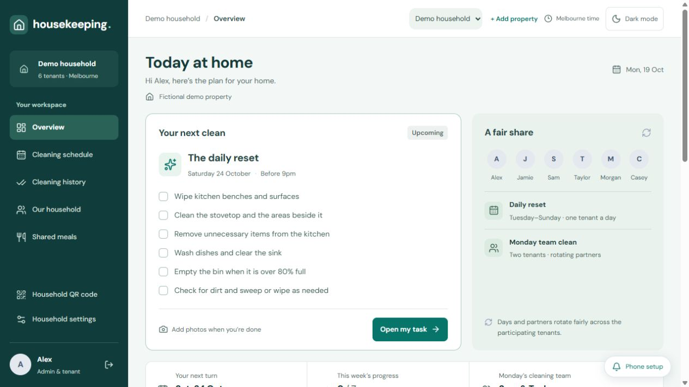
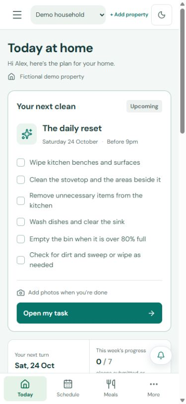
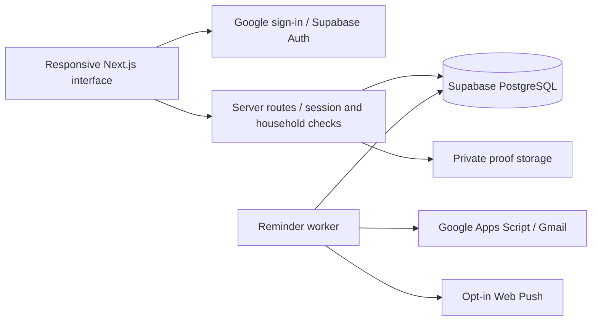

# Housekeeping

I built a household app that makes cleaning and meal duties visible, records completed work and sends reminders so housemates can see who is responsible.



[](https://github.com/iamnajib71/housekeeping/actions/workflows/verify.yml) · [TypeScript source](package.json)

## At a glance

| Area | Evidence-backed summary |
| --- | --- |
| **The problem** | A six-person shared house argues over chores and misses tasks when ownership and completion are unclear, costing housemates time following up. The original household size and scheduling rules are documented in [account setup](docs/ACCOUNT_ONBOARDING.md). |
| **What I built** | I built cleaning rotations, task-level review, private photo proof, shared meals and reminders, with Google sign-in and household-scoped access. |
| **Results** | In daily household use, with [live-service upgrade procedures](docs/UPGRADES.md). [Unit coverage](tests/) and [browser checks](scripts/) exercise scheduling, feedback and access; [CI](.github/workflows/verify.yml) runs unit tests, type checking and a production build. Public previews use fictional data. |
| **Skills shown** | Next.js, TypeScript, Supabase/Postgres row-level security, Google OAuth, Playwright, Vercel, API testing and responsive design. [Access model](docs/ACCOUNT_ONBOARDING.md#access-and-operational-limits). |
| **Relevant roles** | Software Builder, Junior Developer, Junior Full-Stack Developer, QA Analyst. |
| **Try it / evidence** | [App (approved account required)](https://housekeeping-najib.vercel.app) · [Fictional-data preview](#interface) · [Screenshot provenance](docs/screenshots/README.md) · [Local development](#local-development) |

## What I did, step by step

1. Defined duty ownership, rotation and completion rules and added [schedule tests](tests/schedule.test.ts).
2. Built mobile task checklists, photo submissions and individual feedback so accepted work survives resubmission.
3. Added Google sign-in and server-side household checks; kept browser database access denied by default and proof storage private. [Account model](docs/ACCOUNT_ONBOARDING.md).
4. Added reminder queues and opt-in phone notifications with deduplication and ownership checks.
5. Extended the household workflow to private meal groups while retaining existing cleaning history.
6. Checked unit behaviour, browser flows and database guards, then documented [safe upgrades](docs/UPGRADES.md) and captured [fictional-data interface previews](docs/screenshots/README.md).

## Problems I hit and how I solved them

- **OAuth redirects on Vercel used the configured URL rather than the request origin:** changed the callback to use the request origin. [Fixing commit](https://github.com/iamnajib71/housekeeping/commit/75b2f96).
- **Proof submission needed to remain available after midnight:** added a next-morning window using Melbourne wall time and regression checks around daylight-saving and date boundaries. [Recorded change](https://github.com/iamnajib71/housekeeping/commit/053e166) · [tests](tests/submission-window.test.ts).

## Interface

The screenshots show the actual application rendered locally with fictional test fixtures and mocked API responses. Names, property details and assignments are demonstration data. They contain no live household records or proof photos.




[Screenshot provenance and reproduction](docs/screenshots/README.md)

## Features

| Area | Functionality |
| --- | --- |
| Cleaning rota | Rotating daily duties, weekly team cleans and individual task allocations |
| Submissions | Task checklists, optional session timing, compressed photo uploads and retained cleaning history |
| Review | Approve individual tasks, request specific fixes and preserve accepted work during resubmission |
| Shared meals | Private groups, rice duties, batch cooking, groceries and shared trip credit |
| Reminders | Email, opt-in Web Push and Home Screen installation |
| Property management | Administrator and tenant roles, private invitations, household selection and guided setup |
| Privacy | Household-scoped server access, private storage and short-lived proof-image links |

## Architecture



The browser uses Supabase directly for sign-in. Server routes validate the session and household membership before accessing application records. Browser database roles have no household-table privileges. Proof-image links are short-lived; [uploaded proof expires after 15 days](supabase/migrations/20260922045103_household.sql) while task history remains.

## Local development

Use [Node.js 22](package.json). Copy `.env.example` to `.env.local` and configure your own development services. Keep credentials, member contact details, invitation links and private media outside version control. Repository sample records use fictional names.

```sh
npm ci
npm run dev -- --port 3007
npm test
npm run typecheck
npm run build
```

The `/app` route requires an approved account. `/setup` explains the reminder connection. The [documentation preview](docs/screenshots/README.md) renders fictional fixtures without signing into a live household.

## Verification

Unit tests cover scheduling, task allocation, daylight-saving boundaries, reminders, waste duties, feedback and optional session timing. Browser checks cover authentication gates, administrator review, resubmission, mobile navigation and saved theme preferences.

Database integration scripts in `tests/` verify guards, grants, worker leases and ownership isolation inside transactions that roll back their fixtures. Run them only against a dedicated development database. The GitHub Actions workflow runs unit tests, type checking and a production build.

## Deployment and operations

Next.js runs on Vercel, with Supabase providing authentication, database and private storage. Gmail reminders use Google Apps Script; Web Push is opt-in. Builds do not reset or seed the live database.

- [Deployment](docs/DEPLOYMENT.md) and [safe upgrades](docs/UPGRADES.md)
- [Shared meals](docs/SHARED_MEALS.md) and [phone notifications](docs/PHONE_NOTIFICATIONS.md)
- [Walkthrough trial](docs/WALKTHROUGH_TRIAL.md) and [mapping trial](docs/MAPPING_TRIAL.md)

Walkthrough and mapping features are experimental and require their own setup and explicit media-transfer consent. This repository provides source code and fictional examples; deployed households retain their own private configuration and records.

## Honest limits

- The deployed app holds private household data and requires an approved account. Public screenshots use fictional fixtures and mocked API responses.
- Browser and database checks have different scopes; unit CI does not prove every authenticated workflow or actual handset delivery.
- Walkthrough and mapping features are experiments. No measured savings, production-scale benchmark or detection-accuracy result is claimed.
- The documented upgrade process requires a dedicated test database for integration checks and keeps deployment separate from CI.

## Built by Nazmul Hassan

[LinkedIn](https://www.linkedin.com/in/iamnajib71) · [GitHub](https://github.com/iamnajib71)
