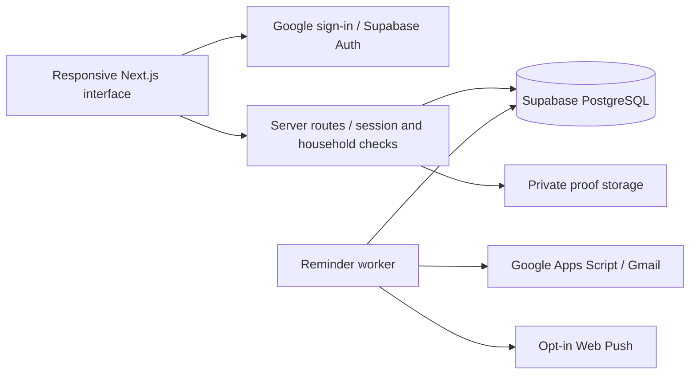

# Housekeeping

A mobile-first household app for cleaning rotas, shared meals, private photo proof and reminders.

[](https://github.com/iamnajib71/housekeeping/actions/workflows/verify.yml)

[Open the app](https://housekeeping-najib.vercel.app) · [Deployment](docs/DEPLOYMENT.md) · [Account setup](docs/ACCOUNT_ONBOARDING.md)

## Interface

The screenshots show the actual application rendered locally with fictional test fixtures and mocked API responses. Names, property details and assignments are demonstration data. They contain no live household records or proof photos.


[Screenshot provenance and reproduction](docs/screenshots/README.md)

## Features

| Area | Functionality |
| --- | --- |
| Cleaning rota | Rotating daily duties, weekly team cleans and individual task allocations |
| Submissions | Task checklists, optional session timing, compressed photo uploads and retained cleaning history |
| Review | Approve individual tasks, request specific fixes and preserve accepted work during resubmission |
| Shared meals | Private groups, rice duties, batch cooking, groceries and shared trip credit |
| Reminders | Email, opt-in Web Push and Home Screen installation |
| Property management | Administrator and tenant roles, private invitations, household selection and guided setup |
| Privacy | Household-scoped server access, private storage and short-lived proof-image links |

## Architecture



The browser uses Supabase directly for sign-in. Server routes validate the session and household membership before accessing application records. Browser database roles have no household-table privileges. Proof-image links expire after a few minutes; uploaded proof expires after 15 days while task history remains.

## Local development

Use Node.js 22. Copy `.env.example` to `.env.local` and configure your own development services. Keep credentials, member contact details, invitation links and private media outside version control. Repository sample records use fictional names.

```sh
npm ci
npm run dev -- --port 3007
npm test
npm run typecheck
npm run build
```

The `/app` route requires an approved account. `/setup` explains the reminder connection. The [documentation preview](docs/screenshots/README.md) renders fictional fixtures without signing into a live household.

## Verification

Unit tests cover scheduling, task allocation, daylight-saving boundaries, reminders, waste duties, feedback and optional session timing. Browser checks cover authentication gates, administrator review, resubmission, mobile navigation and saved theme preferences.

Database integration scripts in `tests/` verify guards, grants, worker leases and ownership isolation inside transactions that roll back their fixtures. Run them only against a dedicated development database. The GitHub Actions workflow runs unit tests, type checking and a production build.

## Deployment and operations

Next.js runs on Vercel, with Supabase providing authentication, database and private storage. Gmail reminders use Google Apps Script; Web Push is opt-in. Builds do not reset or seed the live database.

- [Deployment](docs/DEPLOYMENT.md) and [safe upgrades](docs/UPGRADES.md)
- [Shared meals](docs/SHARED_MEALS.md) and [phone notifications](docs/PHONE_NOTIFICATIONS.md)
- [Walkthrough trial](docs/WALKTHROUGH_TRIAL.md) and [mapping trial](docs/MAPPING_TRIAL.md)

Walkthrough and mapping features are experimental and require their own setup and explicit media-transfer consent. This repository provides source code and fictional examples; deployed households retain their own private configuration and records.